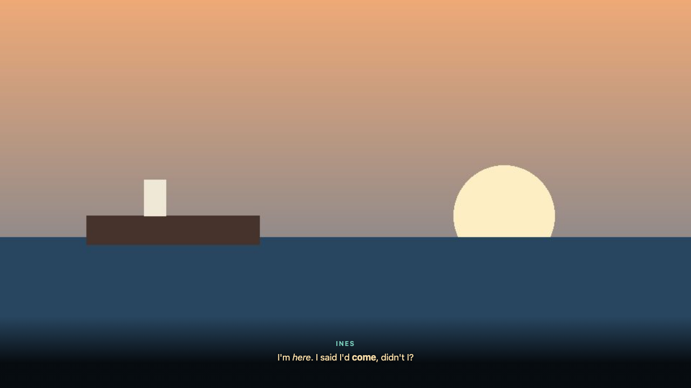
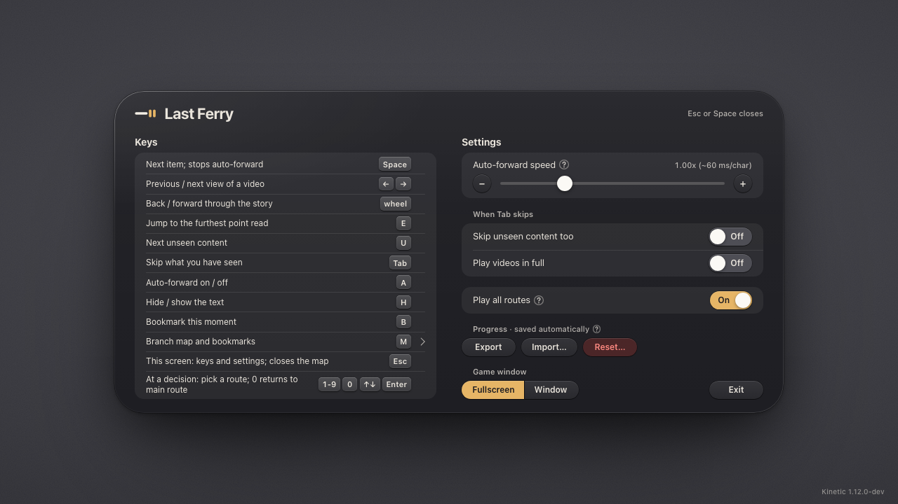
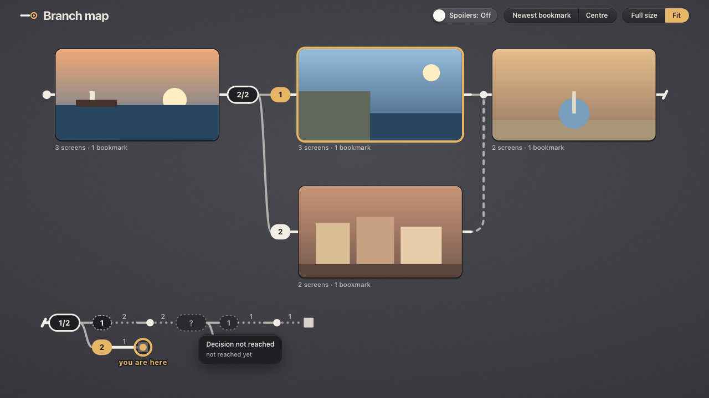
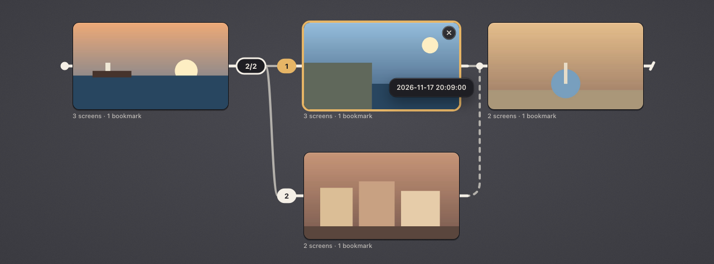

# Kinetic

Kinetic plays kinetic visual novels: stories you read rather than steer,
told in pictures, animation, video, text and sound. A game is a folder.
A reader double-clicks its `index.html` and it plays from disk in a
browser such as Safari or Chrome, or opens the game's own Mac or Windows
app beside it. There is nothing to install, no server and no network. An
author converts an existing Ren'Py game with one command, or writes the
folder by hand.



## Why not Ren'Py?

Ren'Py is an engine for interactive visual novels: menus, variables,
save slots, scripting. A kinetic novel needs little of that and gains
from what Kinetic does instead:

- **Nothing to install.** The folder is the game. `kinetic apps` adds a
  Mac app and a Windows program to it, with no compiler, Xcode or Go on
  the author's machine.
- **Every step within a frame.** Space, the wheel, a jump or a click on
  the map shows the next screen within 1/24 s, measured in
  [docs/perf.md](docs/perf.md).
- **The wheel goes everywhere you have been.** Scroll back and forward
  through everything you have read, across routes and across restarts.
  Ren'Py's rollback keeps a limited history, 128 steps by default.
- **A map of the story.** `m` shows every decision and route, what you
  have played, where you are and your bookmarks. Click a decision or
  route you have reached to go there.
- **No save slots.** Progress saves as you read, and `b` bookmarks a
  moment, which waits on the map where you took it.
- **Every route, hands off.** Play all routes, on by default, reads each
  route in turn, shortest first, so a reader sees the whole story
  without choosing.
- **Many languages, and spoken lines.** One folder holds a game in
  several languages, and the player's own words come in 39. In the apps,
  a game whose characters have voices can speak every line, generated on
  the reader's computer.
- **A conversion you can check without watching.** `kinetic extract`
  reads a Ren'Py game as Ren'Py runs it (`.rpy`, compiled `.rpyc`,
  `.rpa` archives) and keeps its speaker colours, dissolves, fades, text
  tags, translations and sound. `kinetic report`, `routes`, `validate`
  and `check` print what you, or an AI agent doing the conversion, need
  to compare it with the original, and `kinetic media rebuild` remakes
  every media file byte for byte from the original game.

What Kinetic leaves out: game logic, variables, and title or menu
screens. A title card or credits are pictures and text in the story.

## A look around



**Esc** opens the keys and every setting, over anything, a choice
included. Esc or Space closes it.



**m** opens the branch map. The first decision reads 2/2: both its
routes played, a bookmark on each, and the dashed line is the route that
returns to the choice. The second reads 1/2, the route you picked last
marked in gold, with "you are here" on it. The third, not reached yet,
is a faded "?" whose question and routes stay hidden while Spoilers is
off.



**b** bookmarks the moment. Each bookmark is a picture on the map where
you took it, here one on each route of a fork; the newest has a gold
outline, and hovering one shows when you took it and its delete button.
Click one to read on from there.

## For players

Double-click the game's `index.html`, or its app. The browser goes
fullscreen on your first key. Space reads on, the wheel moves back and
forth, and Esc lists everything else. Your place, what you have seen and
your bookmarks are kept for next time; Export and Import on the Esc
screen carry them to another machine.

[docs/player.md](docs/player.md) describes every key, screen and setting
in full.

## For authors

Kinetic's tools are one command, `kinetic`, installed from the Python
wheel on each [GitHub
release](https://github.com/sendub/kinetic/releases) (Python 3.12 or
later). `kinetic setup` then fetches the pinned media tools once:

```sh
python3 -m venv ~/kinetic-venv
~/kinetic-venv/bin/pip install https://github.com/sendub/kinetic/releases/download/v1.12.0/kinetic-1.12.0-py3-none-any.whl
~/kinetic-venv/bin/kinetic setup
```

With `~/kinetic-venv/bin` on your PATH, convert a Ren'Py game, check it
and make the folder readers get:

```sh
kinetic extract ~/games/MyGame my-game
kinetic report my-game
kinetic assemble my-game my-game-play
kinetic check my-game-play --steps all
kinetic apps my-game-play --mac --windows
```

Converting runs on an Apple silicon Mac and on 64-bit Windows or Linux
on Intel or AMD. `kinetic check` also needs Node.js 22.12 or later, and
the Mac app needs a Mac to make it.

[CREATE.md](CREATE.md) is the full guide: every check, episodes, writing
a folder by hand (text tags, speaker colours, transitions, sound),
giving characters voices, translating, the apps and testing.
[docs/content-format.md](docs/content-format.md) specifies the folder,
and [CHANGELOG.md](CHANGELOG.md) lists what each release changed.

## License

Kinetic (the player, the Mac and Windows apps, the converter and the
tools) is under the MIT License, in [LICENSE](LICENSE). The converter's
copy of unrpyc keeps its own MIT notice
(`converter/vendor/unrpyc/LICENSE`); it stays in this repo and never
goes into a game folder.

A game folder carries the notice itself: its `index.html` and `app.js`
open with it as a comment. The Mac app holds it in
`Contents/Resources/LICENSE` and shows a one-line copyright in Finder's
Get Info. The Windows program holds it in its resources, beside Go's
BSD-3-Clause notice for the Go runtime built into it, and shows the
copyright line in its file properties. An author who ships the folder
and apps as built owes nothing more.
